# Mini-CMS

## Description

Mini-CMS est le projet fil rouge de l'Atelier Framework Côté Serveur (Laravel 13, PHP 8.3+, SQLite), réalisé par Yassine Bouazizi (groupe MDW32, ISET Sidi Bouzid).

L'application combine un site public de publication d'articles, un back-office authentifié avec gestion des rôles et une API REST JSON protégée par jetons Sanctum.

## Fonctionnalités

- **Site public** : page d'accueil, liste paginée des articles publiés, filtrage par catégorie, tag ou archive annuelle, détail d'un article.
- **Authentification & rôles** : inscription, connexion, déconnexion par session (`author` et `admin`), protection des routes et gestion des rôles utilisateurs côté administrateur.
- **Back-office** : création, modification, suppression et publication/dépublication d'articles (`PostPolicy`), gestion des catégories et des tags (`admin`).
- **API REST JSON** : lecture des articles (avec filtres `?per_page=`, `?category=` et `?tag=`), lecture des catégories et des tags (avec `posts_count` des articles publiés), authentification par jeton Bearer Sanctum et écritures protégées.
- **Tests Pest** : 97 tests couvrant les pages, l'autorisation, le back-office et l'API en lecture et en écriture.

## Installation

### Bash

```bash
git clone https://github.com/yassinebouazizi-dev/mini-cms.git
cd mini-cms
composer install
npm install
npm run build
cp .env.example .env
php artisan key:generate
touch database/database.sqlite
php artisan migrate:fresh --seed
php artisan test
composer run dev
```

### PowerShell

```powershell
git clone https://github.com/yassinebouazizi-dev/mini-cms.git
cd mini-cms
composer install
npm install
npm run build
copy .env.example .env
php artisan key:generate
New-Item -ItemType File -Force database\database.sqlite
php artisan migrate:fresh --seed
php artisan test
composer run dev
```

L'application est ensuite accessible sur `http://localhost:8000`.

## Comptes de test

La commande `php artisan migrate:fresh --seed` crée les comptes suivants (mot de passe commun : `password`) :

| Rôle | E-mail | Mot de passe |
|---|---|---|
| `admin` | `test@example.com` | `password` |
| `author` | 2 comptes générés aléatoirement par `UserFactory` | `password` |

Vous pouvez aussi créer un compte `author` directement depuis `/inscription`.

## API

Toutes les requêtes API doivent inclure l'en-tête `Accept: application/json`.

### Endpoints

| Méthode | URI | Nom | Protection | Description |
|---|---|---|---|---|
| GET | `/api/posts` | `api.posts.index` | Publique | Liste paginée des articles publiés (`?per_page=1..50`, `?category=<slug>`, `?tag=<slug>`) |
| GET | `/api/posts/{post}` | `api.posts.show` | Publique (`PostPolicy`) | Détail d'un article publié (403 sur un brouillon) |
| GET | `/api/categories` | `api.categories.index` | Publique | Liste des catégories avec `posts_count` (publiés uniquement) |
| GET | `/api/categories/{category}` | `api.categories.show` | Publique | Détail d'une catégorie avec `posts_count` |
| GET | `/api/tags` | `api.tags.index` | Publique | Liste des tags avec `posts_count` (publiés uniquement) |
| GET | `/api/tags/{tag}` | `api.tags.show` | Publique | Détail d'un tag avec `posts_count` |
| POST | `/api/login` | `api.login` | Publique | Vérifie les identifiants et renvoie un jeton Sanctum (`201`) |
| GET | `/api/user` | — | `auth:sanctum` | Profil de l'utilisateur authentifié |
| POST | `/api/logout` | `api.logout` | `auth:sanctum` | Révoque le jeton courant (`204`) |
| POST | `/api/posts` | `api.posts.store` | `auth:sanctum` | Crée un article (`201`) |
| PUT/PATCH | `/api/posts/{post}` | `api.posts.update` | `auth:sanctum` | Met à jour un article (`PostPolicy`) |
| DELETE | `/api/posts/{post}` | `api.posts.destroy` | `auth:sanctum` | Supprime un article (`204`, `PostPolicy`) |

### Authentification par jeton

1. Envoyer `POST /api/login` avec un corps JSON `{"email": "test@example.com", "password": "password"}`.
2. L'API répond `201 Created` avec `token` et `token_type: "Bearer"`.
3. Pour les routes protégées, envoyer l'en-tête `Authorization: Bearer VOTRE_JETON`.
4. `POST /api/logout` supprime uniquement le jeton utilisé pour cette requête (`204 No Content`).

### Codes d'erreur

| Code | Signification |
|---|---|
| `401` | Jeton absent, invalide ou révoqué (`{"message": "Unauthenticated."}`) |
| `403` | Action refusée par `PostPolicy` (ex. modification de l'article d'un autre auteur) |
| `404` | Ressource introuvable en JSON (`{"message": "No query results for model ..."}`) |
| `422` | Données ou paramètre de filtre invalide (messages de validation en français) |

### Exemple curl.exe

Déconnexion (révocation du jeton courant) :

```powershell
curl.exe -X POST -H "Accept: application/json" -H "Authorization: Bearer VOTRE_JETON" http://localhost:8000/api/logout
```

Cette commande renvoie `204 No Content` sans corps de réponse.

## Captures d'écran

### Session 01 à 06

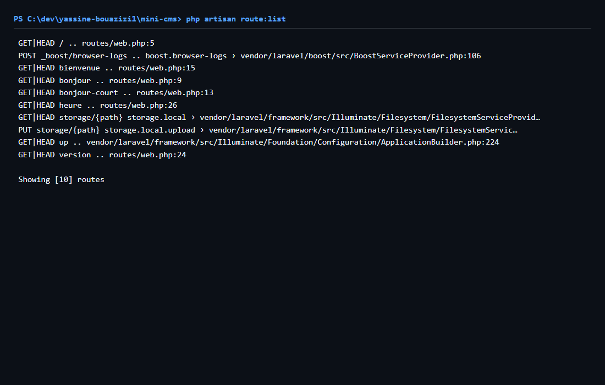

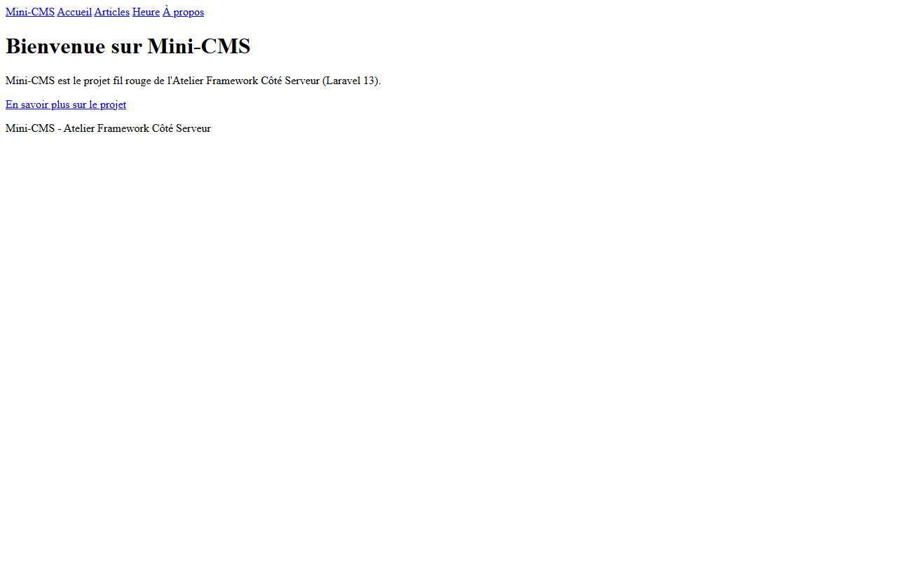

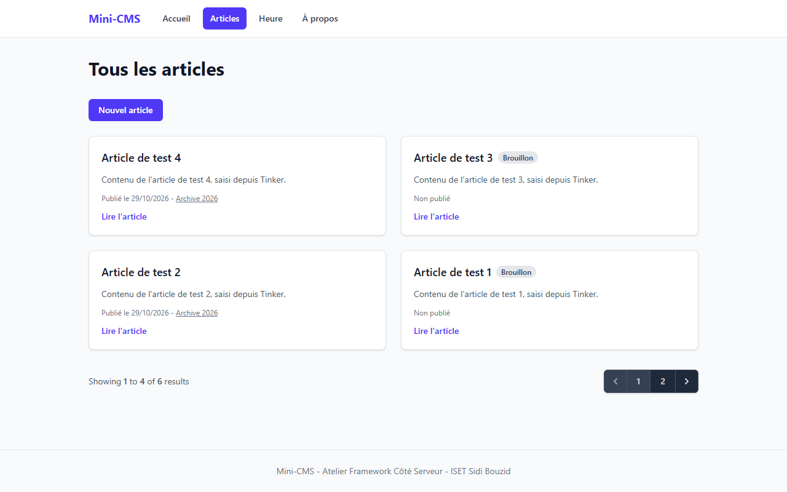

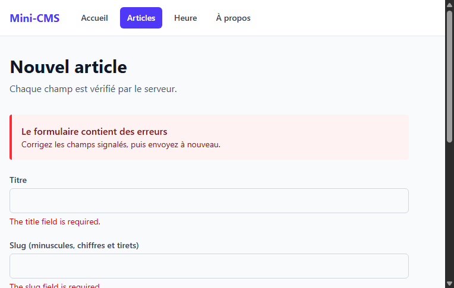

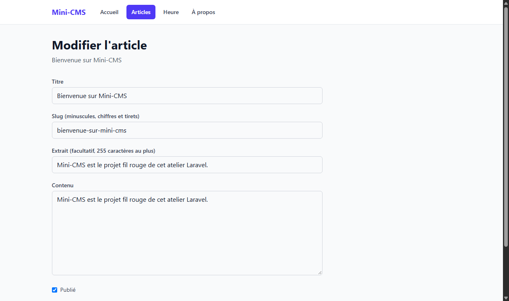

### Session 07 à 12

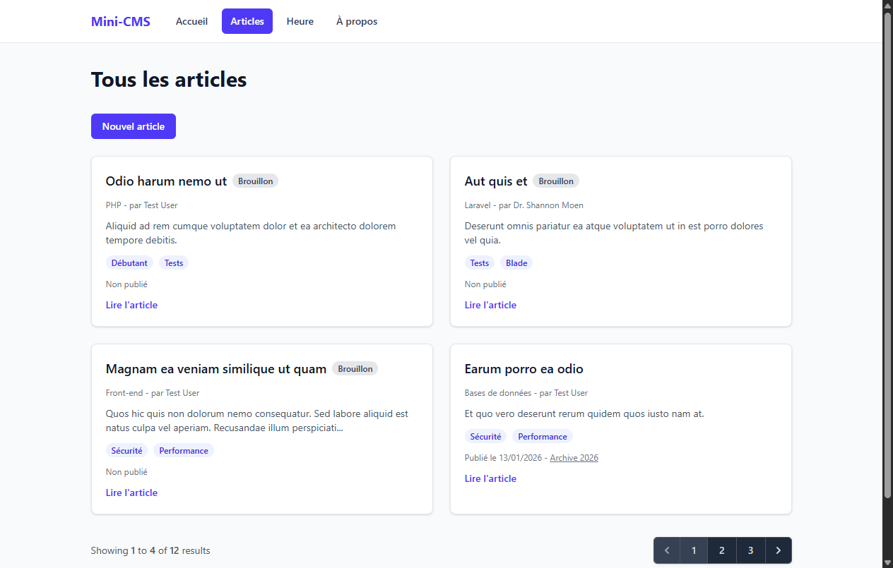

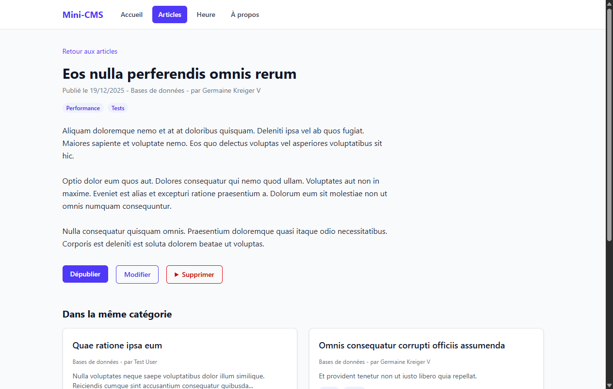

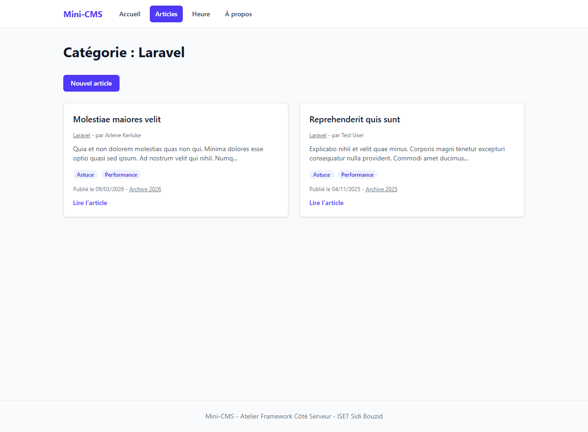

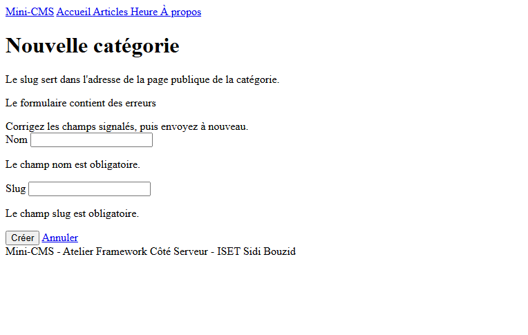


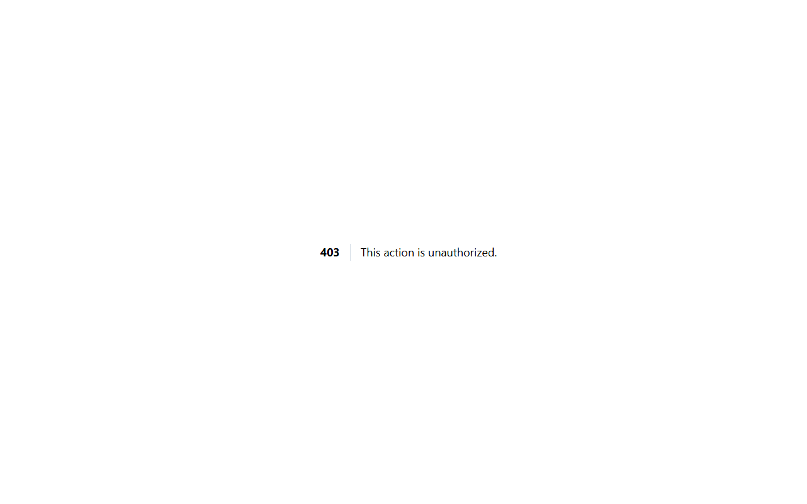

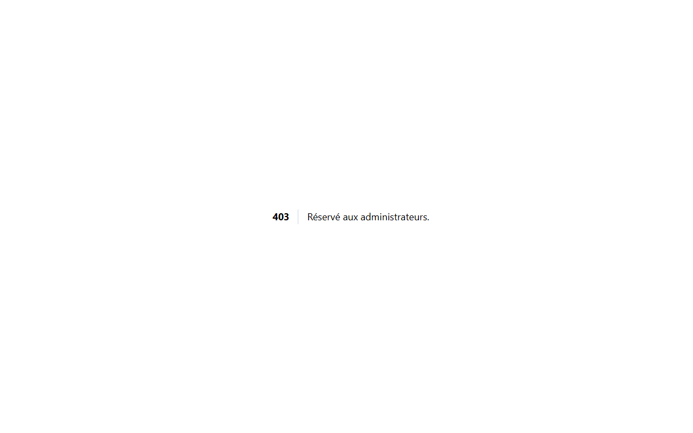

### Session 13 et 14

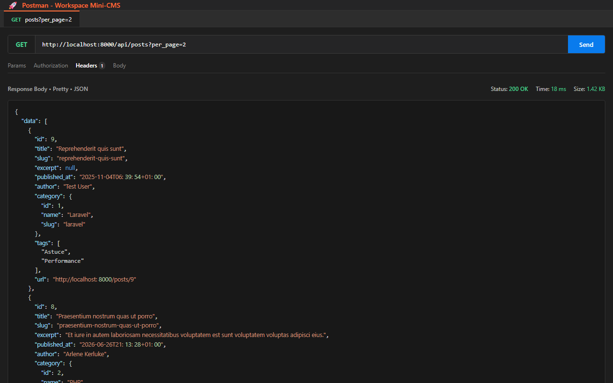

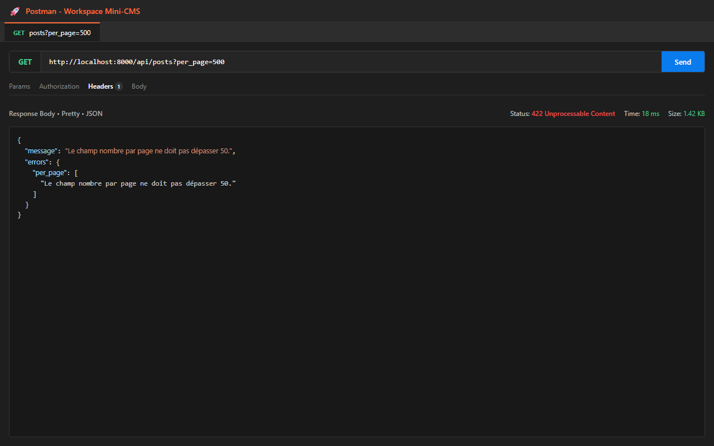


## Choix d'architecture

### Pourquoi les écritures de l'API passent par PostPolicy

Utiliser la même `PostPolicy` et les mêmes Form Requests (`StorePostRequest`, `UpdatePostRequest`) pour le site web et pour l'API garantit qu'il n'y a qu'une seule source de vérité pour les droits et la validation. Si une règle métier change, elle s'applique tout de suite aux deux interfaces, et l'API ne risque pas de devenir un contournement des permissions du site.

### Pourquoi preventLazyLoading est activé

En développement, `Model::preventLazyLoading(! app()->isProduction())` dans `AppServiceProvider` bloque immédiatement toute lecture de relation oubliée dans une boucle, au lieu de laisser passer des requêtes N+1 silencieuses. On est donc obligé de charger les relations à l'avance avec `with()` ou `load()`, tout en gardant la sécurité de ne pas bloquer le site en production.

### Pourquoi l'API utilise des jetons et non la session

Les routes du groupe `api` sont sans état : elles n'utilisent ni cookies ni session PHP. Un client externe comme Postman, `curl.exe` ou une application mobile doit donc prouver son identité à chaque requête avec un jeton Bearer Sanctum, qui peut être révoqué individuellement sans fermer les sessions d'autres appareils.
